# Figures / 图集

[Project](../README.md) · [中文说明](../README.zh-CN.md)

Figures are extracted from the project report. Original map and image source credits remain those of the report.

## Overall analysis workflow

Source: project report, PDF page 2.

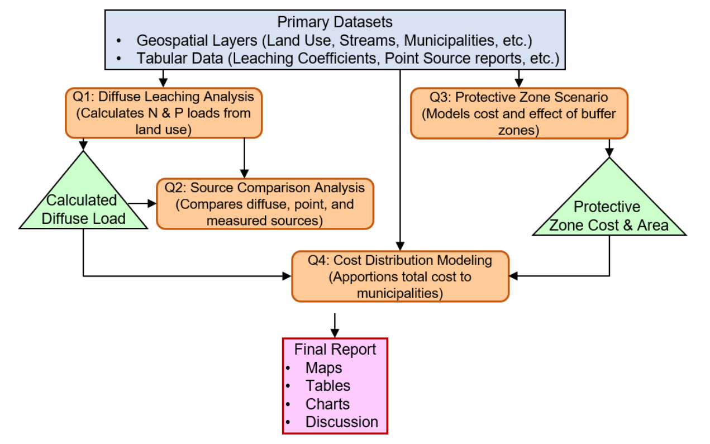

## Diffuse nutrient load workflow

Source: project report, PDF page 4.

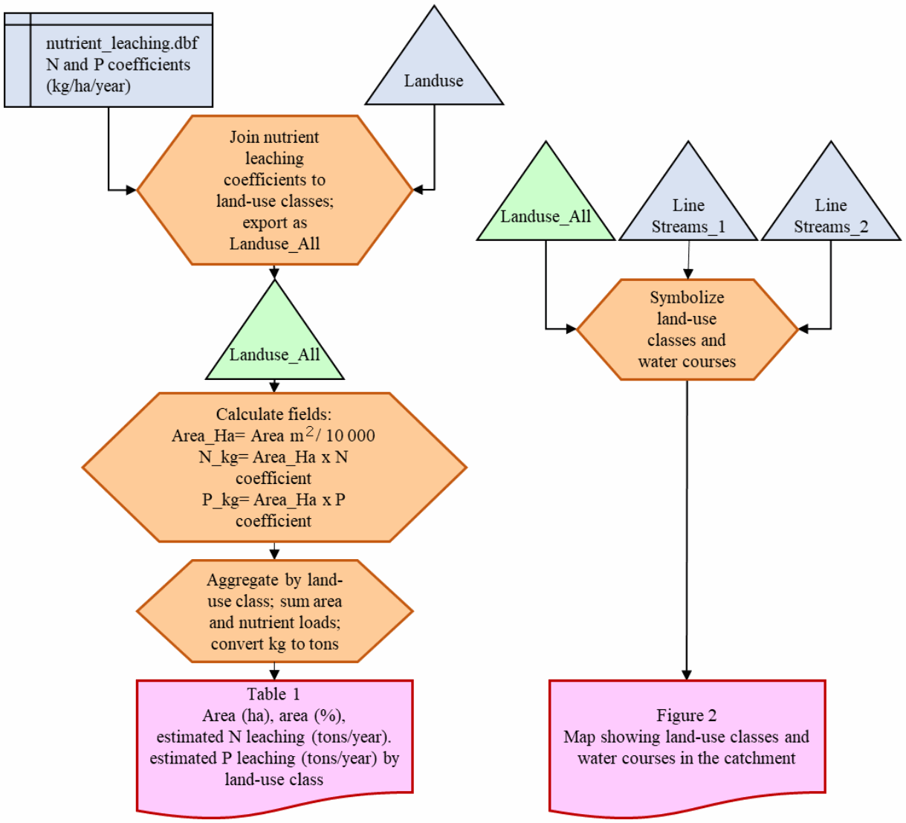

## Land cover and watercourses

Source: project report, PDF page 5.

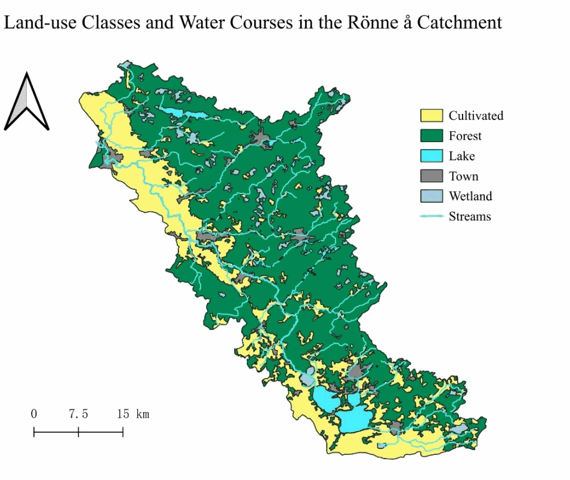

## Point and diffuse source comparison

Source: project report, PDF page 6.

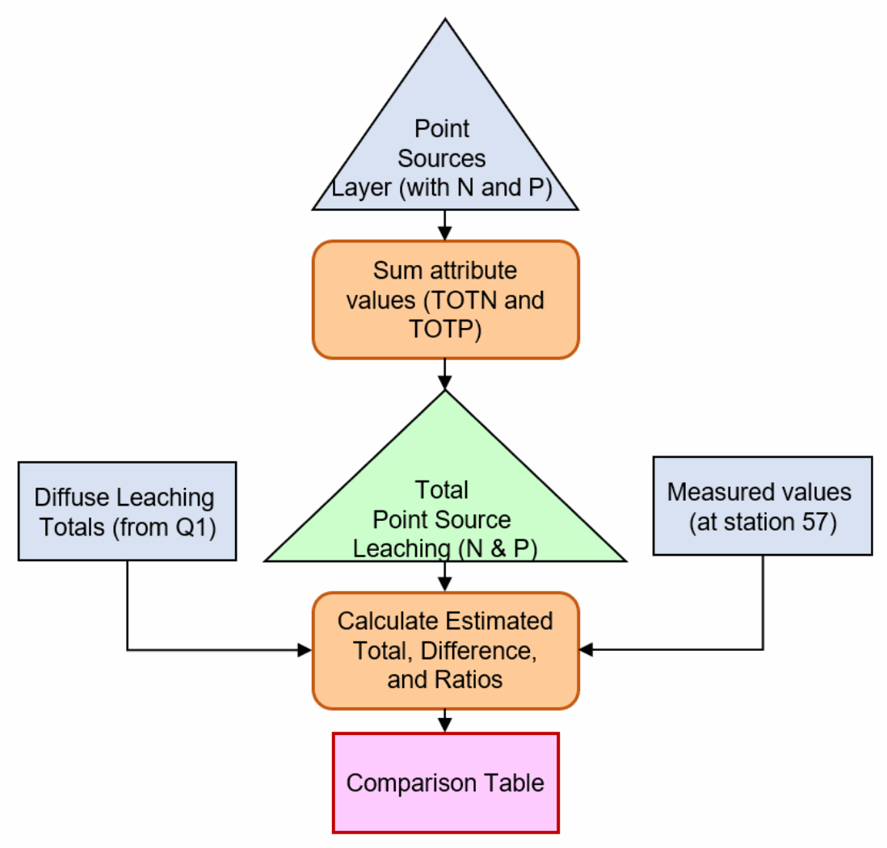

## Nitrogen point sources

Source: project report, PDF page 7.

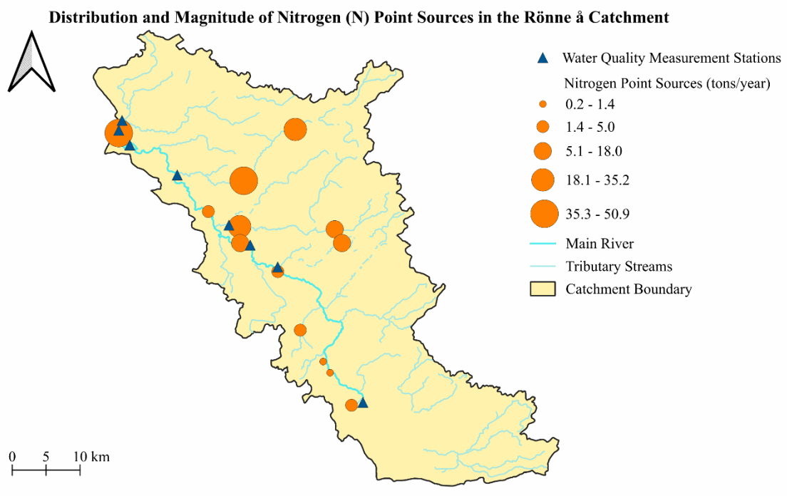

## Phosphorus point sources

Source: project report, PDF page 7.

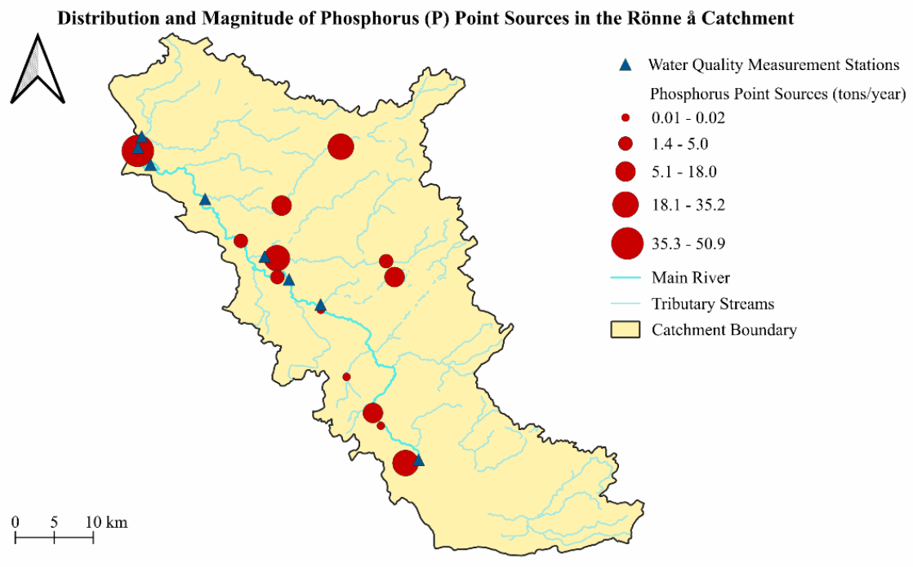

## Buffer-zone calculation workflow

Source: project report, PDF page 9.

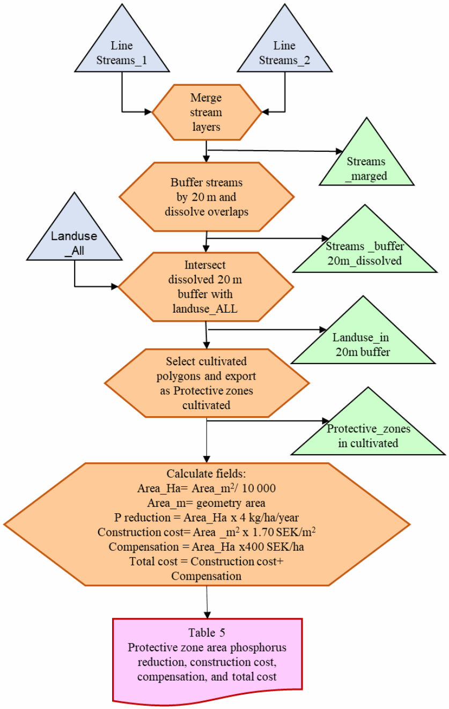

## Costs and retention workflow

Source: project report, PDF page 10.

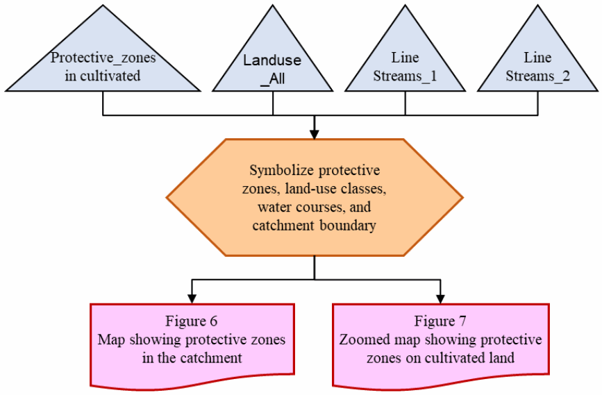

## Candidate protective zones

Source: project report, PDF page 11.

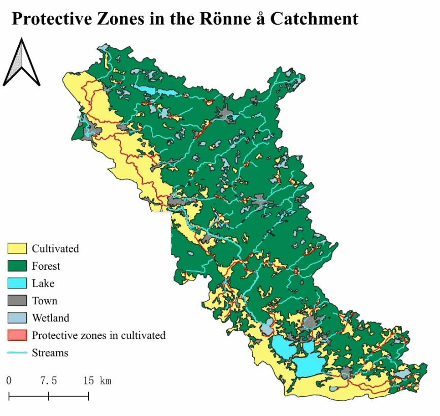

## 20 m stream buffer detail

Source: project report, PDF page 11.

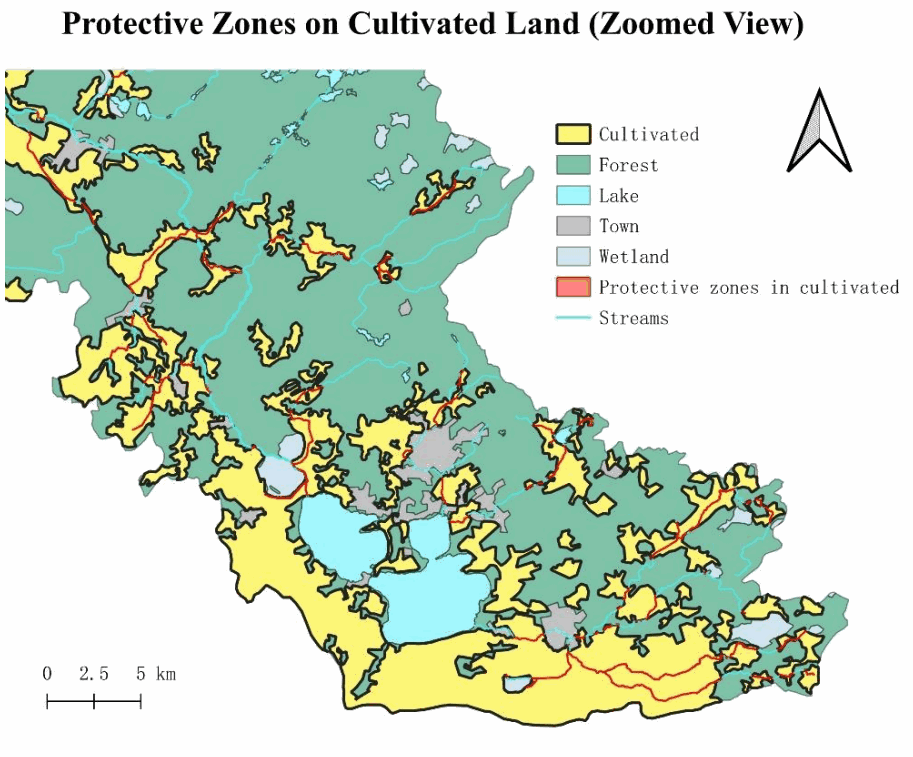

## Municipal cost allocation workflow

Source: project report, PDF page 12.

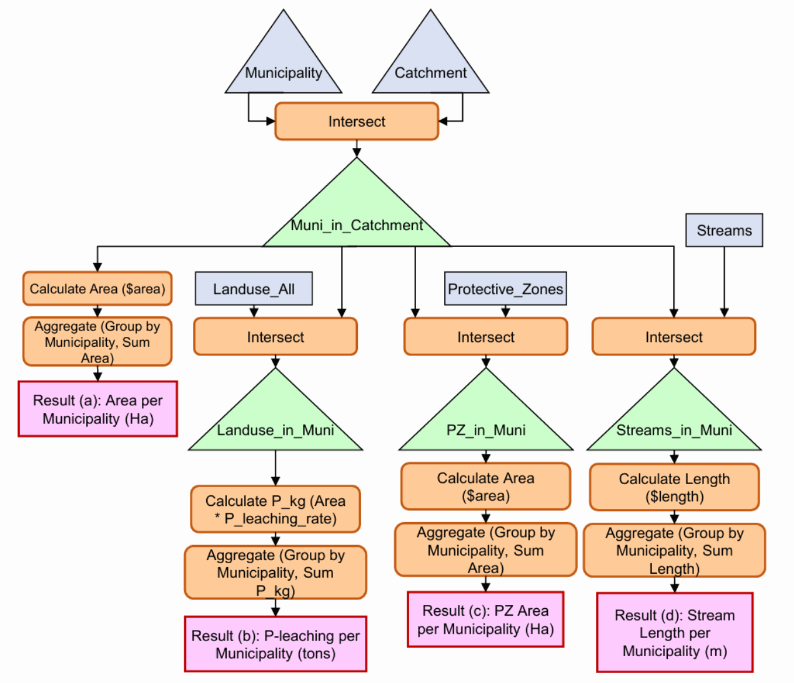

## Catchment location in Skane

Source: project report, PDF page 15.

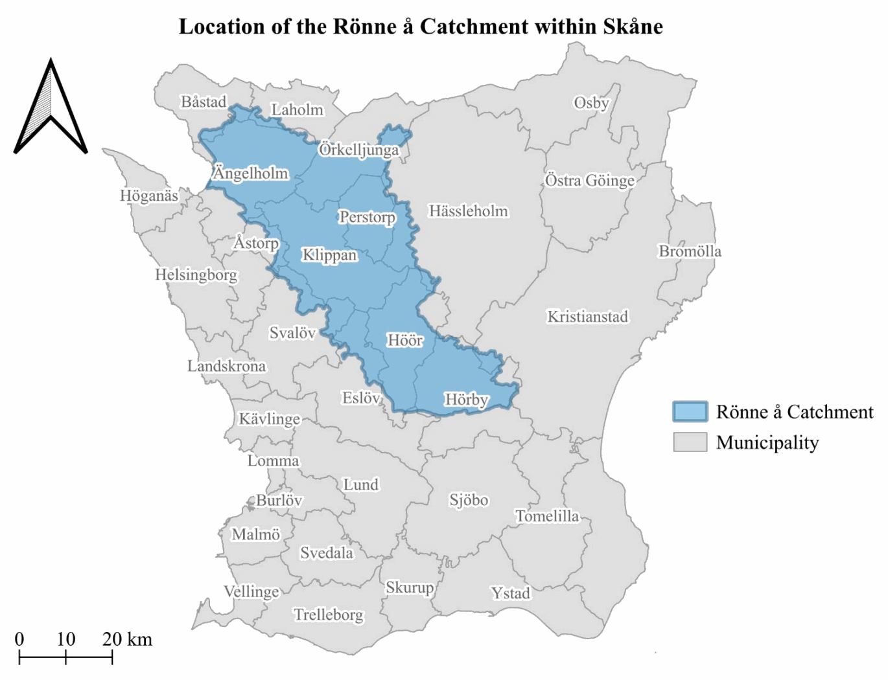

## Land cover, streams and municipal boundaries

Source: project report, PDF page 16.

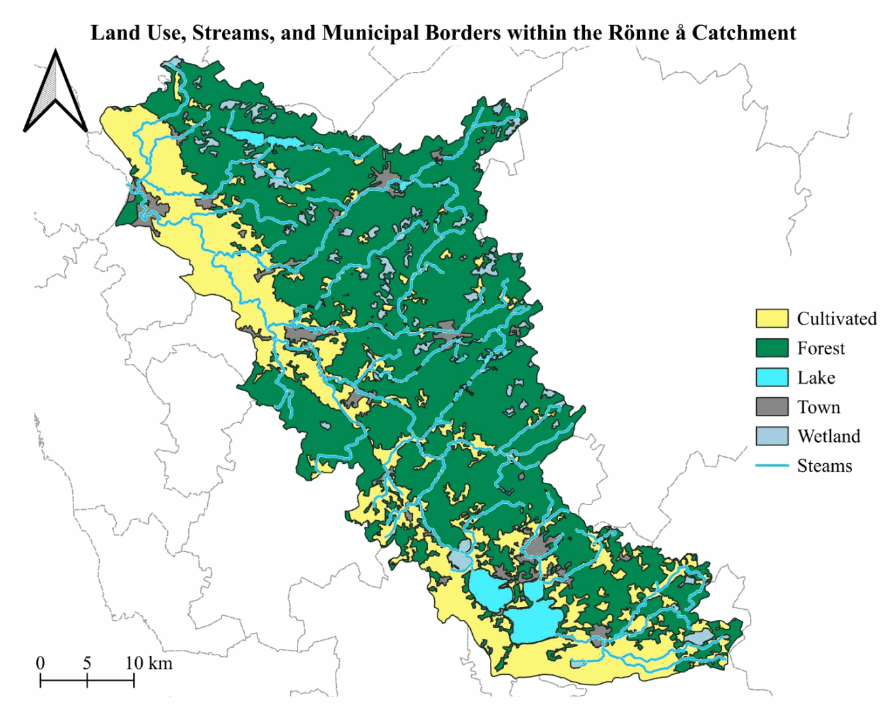

## Municipal cost shares under four allocation principles

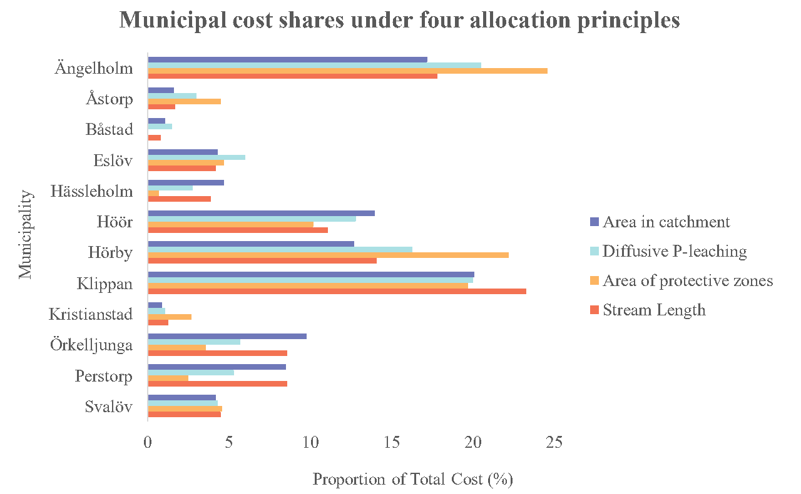
